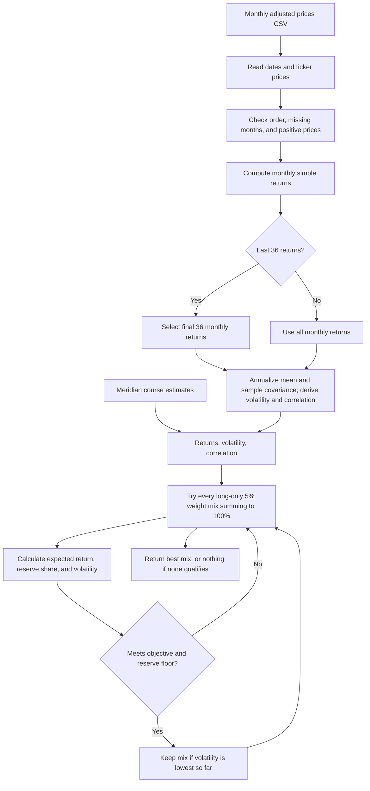

# Project 2 mandate — proposed young-family client

This is a **fictional draft**, not information supplied by an actual couple. Client details, the return goal, the reserve floor, and risk tolerance require confirmation before any investment decision.

## Client, objective, and hard constraint

The clients are a **30-year-old couple with two young children**. They are investing for future education costs and longer-term family wealth, with substantial education withdrawals expected roughly 14–16 years from now. This modeled portfolio is separate from cash they would keep in a bank for emergencies.

Their proposed objective is an **8.0% nominal annual return net of investment costs**, assessed over rolling ten-year periods. The app reports gross expected return, so an illustrative **0.20% annual cost allowance** makes its numeric target **8.2% gross**. This is a target, not a forecast or guaranteed ten-year outcome.

The modeled hard constraint is **at least 10% of the portfolio in SGOV**, a short-Treasury ETF, for near-term family expenses. The 10% figure is a draft policy choice that the couple must confirm. They would hold only long positions in the four approved funds, with weights summing to 100% and no borrowing or derivatives. The app checks the return proxy, long-only weights, and SGOV floor; it does not check taxes, account types, spending plans, or future realized returns.

**Risk tolerance remains unspecified.** Age, children, and an 8% return target do not establish how much loss the couple can tolerate or afford. The app's minimum-volatility choice is a modeling rule, not a client-approved maximum loss or volatility limit. Time horizon and risk tolerance both matter to asset allocation, as [Investor.gov explains](https://www.investor.gov/introduction-investing/getting-started/asset-allocation).

## Four-fund universe and price provenance

The candidates are **SGOV** for short-Treasury exposure, **BND** for broad U.S. investment-grade bonds, **VT** for global equity, and **TIP** for inflation-protected U.S. Treasury bonds. TIP adds an inflation-linked bond sleeve: [Vanguard says BND excludes inflation-protected bonds](https://advisors.vanguard.com/investments/products/bnd/vanguard-total-bond-market-etf), while [iShares describes TIP as a TIPS fund](https://www.ishares.com/us/products/239467/ishares-tips-bond-etf?qt=TIP). TIP's intermediate-duration bonds can still lose market value when real interest rates rise. These are research candidates, not required weights.

`prices.csv` has the month first, then SGOV, BND, VT, and TIP, oldest month first. It contains **61 complete monthly adjusted closes**, September 2021–September 2026, giving **60 monthly return intervals**. The SGOV, BND, and VT chart responses were downloaded **October 20, 2026**; TIP was downloaded **October 22, 2026**. October 2026 was incomplete and excluded. `build_prices.py` reads the `adjclose` field from each saved response, aligns months, and writes prices rounded to six decimals.

| Ticker | Recorded adjusted-close source | Saved response | Download date |
|---|---|---|---|
| SGOV | [Yahoo Finance chart](https://query2.finance.yahoo.com/v8/finance/chart/SGOV?period1=1630454400&period2=1790812800&interval=1mo&includeAdjustedClose=true) | `source/sgov_yahoo.json` | 2026-10-20 |
| BND | [Yahoo Finance chart](https://query2.finance.yahoo.com/v8/finance/chart/BND?period1=1630454400&period2=1790812800&interval=1mo&includeAdjustedClose=true) | `source/bnd_yahoo.json` | 2026-10-20 |
| VT | [Yahoo Finance chart](https://query2.finance.yahoo.com/v8/finance/chart/VT?period1=1630454400&period2=1790812800&interval=1mo&includeAdjustedClose=true) | `source/vt_yahoo.json` | 2026-10-20 |
| TIP | [Yahoo Finance chart](https://query2.finance.yahoo.com/v8/finance/chart/TIP?period1=1630454400&period2=1790812800&interval=1mo&includeAdjustedClose=true) | `source/tip_yahoo.json` | 2026-10-22 |

The engine computes monthly simple returns as `current adjusted close / previous adjusted close − 1`; it annualizes the arithmetic mean by multiplying by 12 and sample covariance by multiplying by 12. Volatility is the square root of annual covariance's diagonal, and correlation comes from monthly returns. These are **historical estimates, not forecasts**.

| Fund | All-60 annualized historical mean return | Annualized historical volatility |
|---|---:|---:|
| SGOV | 3.72% | 0.50% |
| BND | −0.42% | 6.45% |
| VT | 11.90% | 14.92% |
| TIP | 0.00% | 6.11% |

## App settings and both price windows

Upload `prices.csv`. Set the **gross objective to 8.2%** and the **reserve minimum to 10%**; tick **SGOV** as reserve-eligible and leave BND, VT, and TIP unticked. The app searches every long-only mix in 5-percentage-point steps and chooses the lowest modeled volatility among qualifying mixes. Keep the objective and reserve rule fixed when switching price windows.

| Return window | SGOV / BND / VT / TIP | Expected gross / net return | Modeled volatility | SGOV reserve |
|---|---|---:|---:|---:|
| All 60 monthly returns, Oct 2021–Sep 2026 | 45% / 0% / 55% / 0% | 8.21% / 8.01% | 8.25% | 45% |
| Last 36 monthly returns, Oct 2023–Sep 2026 | 75% / 0% / 25% / 0% | 8.39% / 8.19% | 2.95% | 75% |

Both windows produce a qualifying grid mix. The **largest weight change is 30 percentage points**, in SGOV and VT. The shorter window's VT historical mean is **20.25%**, compared with **11.90%** across all 60 months; its stronger recent sample should not be treated as a forward return forecast. BND and TIP receive zero weight in these sample-based solutions. TIP's near-zero five-year historical mean makes it unattractive to this return-constrained optimizer; that does not prove its inflation-linked exposure has no value to the family.

## One-point estimate change and partner attack

On **all 60 months**, lowering VT's return estimate by one percentage point from 11.90% to 10.90% makes the original 45/0/55/0 mix earn only **7.66% gross**, below the unchanged 8.2% target. The new grid answer is **35% SGOV / 0% BND / 65% VT / 0% TIP**, with **8.38% gross return** and **9.73% volatility**: a **10-point** largest weight change from one estimate.

**Partner response, two sentences:** My partner questioned VT's **20.25%** last-36-month historical mean because the recent bull market could overstate future equity returns; the all-60-month mean is **11.90%**. Lowering the last-36 VT estimate by one point to **19.25%** changes the app's four-fund mix from **75/0/25/0** to **70/0/30/0** and modeled volatility from **2.95%** to **3.53%**, while the new mix still clears the unchanged **8.2% gross target**.

## My call and client question

**Pilot, not adopt:** use the all-month **45% SGOV / 0% BND / 55% VT / 0% TIP** result as a research starting mix. The **30-point** window change, the all-month **10-point** response to a one-point VT estimate cut, and the couple's unknown loss tolerance make adoption premature. I would change the call only after the couple confirms the SGOV liquidity rule and states an acceptable loss measure and limit, and the expected returns are reviewed with forward-looking assumptions rather than historical averages alone. TIP is now in the candidate universe, but the current estimates do not justify a positive grid weight under this objective.

**One question for the couple:** What one-year portfolio decline could you tolerate without changing your education savings plan, and what should trigger a review or a change in allocation? This asks for an operational risk preference rather than guessing from their age or return target.

## Estimation risk — explain to a partner

Estimation risk is the chance that sample-based returns, volatility, or correlations differ from future values. The search amplifies it when an expected-return floor is nearly binding: the all-month 45/0/55/0 mix earns only **8.21% gross**, about **0.01 percentage points** above the 8.2% floor, so a one-point reduction in VT's estimate makes that mix fail and moves **10 points** into VT. The **30-point** all-month versus last-36-month shift reflects changes in returns, volatilities, and correlations together; it cannot be attributed to the return estimate alone.

## Meridian known-answer and engine check

The app reproduced the course Meridian grid: **0 / 20 / 25 / 55**, **6.51% return**, **9.44% volatility**. Editing Meridian's equity return from 8.0% to 7.0% produced **0 / 10 / 10 / 80**, **6.53% return**, **12.94% volatility**, a **25-point** largest weight change. Temporarily changing both IG–equity correlation cells in `portfolio.py` from 0.25 to 0.50 produced **0 / 40 / 0 / 60**, **6.52% return**, **9.73% volatility** in the app; both cells were restored to 0.25. `python portfolio.py` still prints Tuesday's baseline rows unchanged.

## `portfolio.py` flowchart

