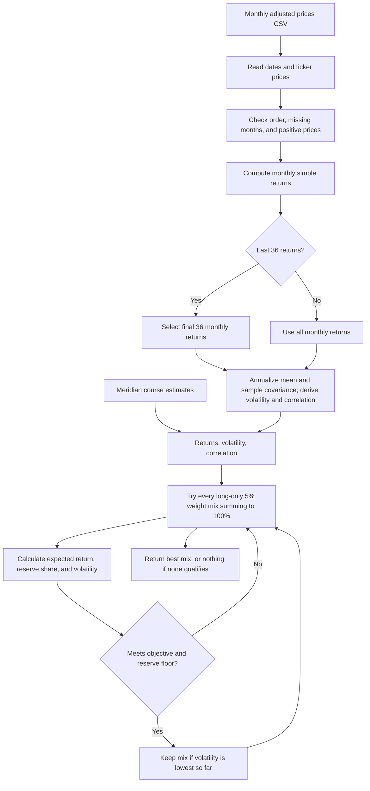

# Project 2 mandate — proposed scholarship client

This is a **draft fictional client mandate**. No client facts were supplied. The policy and dollar amounts need client approval before use.

## Client, objective, and one hard constraint

A community scholarship fund has a $5 million investment reserve and plans to pay $50,000 at the end of each quarter. Its horizon is at least seven years. It seeks **estimated CPI + 3.0 percentage points annually, net of costs, over rolling five-year periods**. At an illustrative 2.5% CPI estimate, the numerical net objective is **5.5%**. An illustrative 0.20% annual cost allowance makes the app's gross return threshold **5.7%** when testing this mandate. This is a proxy, not a promised five-year outcome.

The modeled hard constraint is **at least 4% of assets in SGOV**, the short-Treasury ETF. At today's asset value, 4% is $200,000, equal to four scheduled payments. This draft client policy expressly treats SGOV shares as eligible for the reserve; confirm that choice with the client, including ETF price and settlement risk. Meridian's separate policy does **not** automatically count SGOV.

Other draft rules: long-only; weights sum to 100%; no borrowing, short sales, or derivatives; at least 90% redeemable within five business days; annual rebalancing; committee approval for turnover over 25%. The app checks the allocation and SGOV floor. Liquidity terms and turnover need separate evidence.

## Three-fund universe and price sources

The pilot funds are **SGOV** (short Treasury exposure and proposed reserve asset), **BND** (broad U.S. investment-grade bonds), and **VT** (global equity). They are candidates, not prescribed weights.

`prices.csv` has the date first, then one column per ticker, oldest month first. It contains **61 complete monthly adjusted closes**, September 2021–September 2026, for **60 monthly return intervals**. The file was built from the saved Yahoo Finance chart `adjclose` responses on **October 20, 2026**. October 2026 was incomplete and excluded. Each monthly price is the final adjusted close for that month, rounded to six decimals; Yahoo may later revise adjusted prices.

| Ticker | Adjusted-close download source | Local saved response | Download date |
|---|---|---|---|
| SGOV | [Yahoo Finance chart](https://query2.finance.yahoo.com/v8/finance/chart/SGOV?period1=1630454400&period2=1790812800&interval=1mo&includeAdjustedClose=true) | `source/sgov_yahoo.json` | 2026-10-20 |
| BND | [Yahoo Finance chart](https://query2.finance.yahoo.com/v8/finance/chart/BND?period1=1630454400&period2=1790812800&interval=1mo&includeAdjustedClose=true) | `source/bnd_yahoo.json` | 2026-10-20 |
| VT | [Yahoo Finance chart](https://query2.finance.yahoo.com/v8/finance/chart/VT?period1=1630454400&period2=1790812800&interval=1mo&includeAdjustedClose=true) | `source/vt_yahoo.json` | 2026-10-20 |

`build_prices.py` reproduces the CSV from those saved responses. The engine computes each monthly simple return as `price_this_month / price_last_month - 1`, annualizes the arithmetic monthly mean by multiplying by 12, and annualizes sample covariance by multiplying by 12. Volatility is the square root of annual covariance's diagonal; correlation comes from monthly returns. These are **five-year historical estimates, not forecasts**.

| Fund | Annualized historical mean return | Annualized historical volatility |
|---|---:|---:|
| SGOV | 3.72% | 0.50% |
| BND | −0.42% | 6.45% |
| VT | 11.90% | 14.92% |

## Lowest-risk mix and one-point estimate change

The Lab 14 app searches **every long-only mix in 5-percentage-point steps**. It keeps mixes with weights summing to 100%, expected gross return at least 5.7%, and SGOV weight at least 4%, then chooses the lowest modeled volatility. To reproduce this mandate in the app, set the sidebar objective to **5.7% gross** and reserve floor to **4%**; the displayed return is gross, before the separate 0.20% cost allowance. The challenge lowers **one estimate**, VT's annualized expected return, by **one percentage point**, from 11.90% to 10.90%. The mandate, cost allowance, volatilities, and correlations stay fixed.

| VT return estimate | SGOV / BND / VT weights | Expected gross / net return | Modeled volatility | Reserve-eligible SGOV |
|---|---|---:|---:|---:|
| Base: 11.90% | 75% / 0% / 25% | 5.76% / 5.56% | 3.82% | 75% |
| Stress: 10.90% | 70% / 0% / 30% | 5.87% / 5.67% | 4.55% | 70% |

Under the lower VT estimate, the original mix earns only **5.31% expected net return** and misses the unchanged 5.5% target. The new grid answer has about **0.74 percentage points more modeled volatility**. BND has a negative historical sample mean and receives zero weight in both solutions; that result should be challenged rather than treated as a forward-looking judgment. The grid answer can differ from an unrestricted continuous optimum because each weight moves in 5-point steps.

## All months versus the last 36

I uploaded `prices.csv` in the app and set the **gross objective to 5.7%** and the **reserve minimum to 4%**, with **SGOV ticked as reserve-eligible**. The objective stayed fixed when I switched the return window; the 0.20% cost allowance is applied separately when reading net return.

| Price window | SGOV / BND / VT weights | Expected gross / net return | Modeled volatility | Eligible reserve |
|---|---|---:|---:|---:|
| All 60 monthly returns, Sep 2021–Sep 2026 | 75% / 0% / 25% | 5.76% / 5.56% | 3.82% | 75% |
| Last 36 monthly returns, Oct 2023–Sep 2026 | 90% / 0% / 10% | 6.02% / 5.82% | 1.21% | 90% |

Both windows have a qualifying 5-point-grid mix. The **largest weight change is 15 percentage points**, in both SGOV and VT. The last-36-month VT historical return estimate is 20.25%, compared with 11.90% over all 60 months; the shorter window includes the recent strong equity period and should not be treated as a forecast.

### Partner attack — two-sentence response

My partner challenged the VT return estimate because the recent bull market lifts the last-36-month annualized historical mean to **20.25%**, versus **11.90%** over all 60 months. Lowering the last-36 VT estimate by one percentage point to **19.25%** leaves the grid answer at **90% SGOV / 0% BND / 10% VT**, with **5.92% gross return** and **1.21% volatility**, above the unchanged **5.7% gross objective**.

## My call — Project 2 starting allocation

**Pilot, not adopt:** use the all-month **75% SGOV / 0% BND / 25% VT** grid answer as a research starting allocation. The last-36-month estimate produces **90% / 0% / 10%**, a **15-point** change in the largest weight, and the all-month VT estimate is sensitive enough that a one-point haircut makes the original mix miss the return target. I would move from pilot to adopt only after the client and committee approve the reserve definition for SGOV and independently review conservative forward return estimates; until then this is a model result, not a trade instruction.

## Estimation risk — explain to a partner

**What it is:** The risk that returns, volatilities, or correlations estimated from a limited sample differ from what will happen next. The five-year arithmetic means in this file are historical estimates, not forecasts.

**Why the optimizer amplifies it:** The search chooses the least volatile mix that just clears the return and reserve floors. The all-month 75/0/25 mix earns **5.76% gross**, only about **0.06 percentage points** above the 5.7% threshold; cutting VT's expected return by one point lowers that same mix to **5.51% gross**, so it fails and the grid search jumps to **70% SGOV / 0% BND / 30% VT** with **4.55% volatility**. A small change in one return estimate moves **5 percentage points** of the allocation because the binding threshold changes which mixes qualify.

**My window example:** Switching from all 60 to the last 36 monthly returns moves the largest weight **15 points**, from 75% to 90% SGOV. That comparison changes returns, volatilities, and correlations together, so the whole 15-point move should not be attributed to the VT return estimate alone; it shows how sensitive the selected mix is to the estimation window. In the last-36-month case, a one-point VT haircut leaves the 90/0/10 mix unchanged because its stressed **5.92% gross return** still clears the **5.7%** floor.

## One question for the client

**Must the SGOV reserve be restored immediately after each quarterly payout, or only at annual rebalancing?** This determines when the 4% floor is tested and how much must be sold between reviews.

## Partner explanation, without the app

“My proposed client is a $5 million scholarship fund paying $50,000 each quarter. My universe is three funds: SGOV for short Treasury exposure, BND for investment-grade bonds, and VT for global equity. The objective is 5.5% a year net under the exercise's CPI assumption. The hard rule in my optimizer is at least 4% in SGOV, which the draft client policy explicitly counts as its payout reserve. My estimates come from five years of monthly adjusted prices; they are history, not a forecast. I lower VT's estimated return by one percentage point to test whether the same allocation still meets the mandate.”

Ask your partner to write down **SGOV/BND/VT, the 5.5% net objective, and the 4% SGOV floor**, then swap roles.

## Known-answer and engine check

The app's Meridian grid was checked against the lesson's expected values on October 22, 2026. The same results came from `search_five_point_mix` in `portfolio.py`.

| Run | Bills / 10-year / IG / equity | Return | Volatility |
|---|---|---:|---:|
| As loaded | 0 / 20 / 25 / 55 | 6.51% | 9.44% |
| Equity return estimate 8.0% → 7.0% | 0 / 10 / 10 / 80 | 6.53% | 12.94% |
| Both IG–equity correlation cells 0.25 → 0.50 | 0 / 40 / 0 / 60 | 6.52% | 9.73% |

The equity estimate edit changes the largest weight by **25 percentage points**. The correlation change was made in both symmetric cells of `portfolio.py`; the app showed the new answer, confirming that it imports the engine's inputs and math. Both cells were restored to **0.25**, and the original loaded answer reappeared. `python portfolio.py` still prints Tuesday's three baseline rows unchanged.

## `portfolio.py` flowchart

